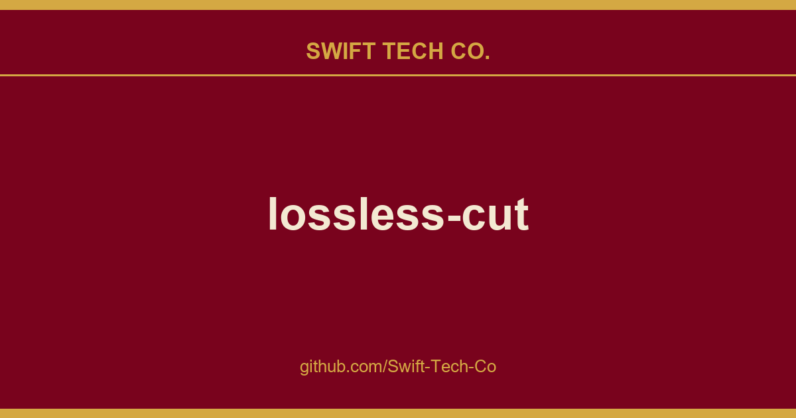
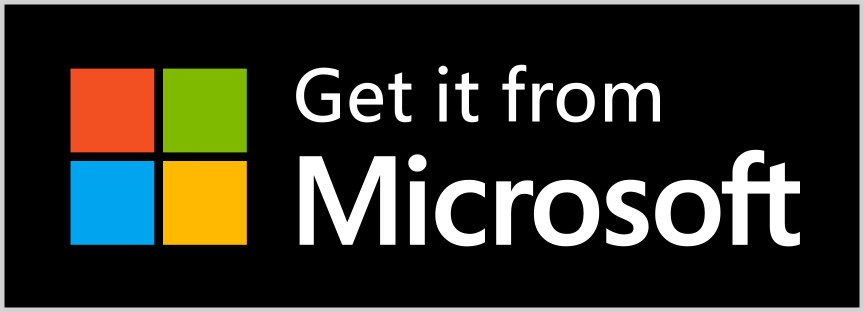

# lossless-cut

## What This Is

We keep a working index for product and engineering, and lossless-cut is the entry that collects our notes, examples and fixes. It reflects how Swift Tech Co. actually uses this in builds and client work.

## Images

## Table of contents

- [Features](#features)
- [Example lossless use cases](#example-lossless-use-cases)
- [Download](#download)
- [Supported formats](#supported-formats)
- [Documentation, usage & getting started](#documentation)
- [Video demos](#video-demos)
- [Featured](#featured)
- [Attributions](#attributions)

## Features

- Lossless cutting of most video and audio formats
- Smart cut (experimental)
- Losslessly cut out parts of video/audio (for cutting away commercials etc.)
- Losslessly rearrange the order of video/audio segments
- Lossless merge/concatenation of arbitrary files (with identical codecs parameters, e.g. from the same camera)
- Lossless multi track/stream editing
  - Combine arbitrary tracks from multiple files (ex. add music or subtitle track to a video file)
  - Remove unneeded tracks
  - Replace or re-encode only some tracks
  - Extract all tracks from a file (extract video, audio, subtitle, attachments and other tracks from one file into separate files)
- View technical data about all tracks. Edit file metadata, per-track metadata and per-track disposition
- Select video/audio tracks for playback. Playback multiple audio tracks simultaneously.
- Fast multi-file workflow (note: no mass/batch export yet)
- Keyboard shortcut workflow
- Losslessly remux video/audio into a different container (file) format
- Take full-resolution snapshots from videos in JPEG/PNG format (low or high quality)
- Export ranges of video frames to images (every nth frame, second, by scene change, best thumbnails)
  - Export only from a selected time range (segment)
  - Optionally include original timestamps in image file names
- Manual input of cutpoint times
- Apply a per-file timecode offset (and auto load timecode from file)
- Change rotation/orientation metadata in videos
- Timeline zoom and frame/keyframe jumping for cutting around keyframes
- Video thumbnails and audio waveform
- Saves per project cut segments to project file
- View FFmpeg last command log so you can modify and re-run recent commands on the command line
- Undo/redo
- Advanced segment query and mutation JS-based expression language.
- Give labels to cut segments, annotate with tags
- [Import/export](docs/index.md#importexport-projects) segments: MP4/MKV chapter marks, Text file, YouTube, CSV, CUE, XML (DaVinci, Final Cut Pro) and more
- MKV/MP4 embedded chapters marks editor
- View subtitles
- Customizable keyboard hotkeys
- Black scene detection, silent audio detection, and scene change detection
- Divide timeline into segments of length L, size (X MB), N number of segments or even randomized segments!
- Speed up / slow down video or audio file (changing FPS)
- Lossless crop and aspect ratio modification
- Basic [CLI](docs/cli.md) and [HTTP API](docs/api.md)
- Show (DJI) embedded GPS track on a map
- Losslessly Download videos over HTTP (e.g. HLS `.m3u8`)
- Extremely fast removal of all non-keyframes (e.g. timelapse)

## Example lossless use cases

- Cut out commercials from a recorded TV show (and re-format from TS to MP4).
- Remove audio tracks from a file.
- Extract music track from a video and cut it to your needs.
- Add music to a video (or replace existing audio track).
- Combine audio and video tracks from separate recordings.
- Include an external subtitle into a video
- Quickly change a H264/H265 MKV video to MOV or MP4 for playback on iPhone.
- Import a list of cut times from other tool as a EDL (edit decision list, CSV) and run these cuts with LosslessCut.
- Export a list of cut times as a CSV EDL and process these in another tool.
- Quickly cut a file by its MP4/MKV chapters.
- Quickly cut a YouTube video by its chapters (or music times from a comment).
- Change the language of a file's audio/subtitle tracks.
- Attach cover art / thumbnail to videos / audio from an external JPEG file or from a frame on the timeline.
- Change author, title, GPS position, recording time of a video.
- Fix rotation of a video that has the wrong orientation flag set.
- Loop a video / audio clip X times quickly without re-encoding, see #284.
- Convert a video or parts of it into X image files (not lossless)
- Losslessly split a video into one file per scene (note you probably have to shift segments, see #330.)
- Cut away silent parts from an audio/video file.
- Annotate each segment with one or more tags, then use those tags to organize your segments or use it to create an output folder structure or hierarchy for your segments.

See also [Recipe cookbook](docs/recipes.md)

## Download

If you want to support my continued work on LosslessCut, and you want the advantage of a secure and simple installation process with automatic, stable updates, consider getting it from your favorite store:

 

For Linux I publish to the Snap Store:

If you prefer to download the executables manually, this will of course always be free (see also [supported operating systems](docs/requirements.md)):

- macOS: Intel / Apple Silicon DMG (note that PKG does **not** work)
- Windows: 7zip (Windows 7, 8 and 8.1 is [no longer supported after v3.50.0](docs/requirements.md))
- Linux: x64 tar.bz2 / x64 AppImage / arm64 tar.bz2 / Raspberry Pi armv7l
- More releases - Note that APPX (Windows) and PKG (macOS) do **not** work)
- Latest nightly builds 🧪

## Supported formats

LosslessCut uses the Chromium browser's HTML5 video player, and not all formats/codecs are natively supported. Generally, the following file formats work: `MP4`, `MOV`, `WebM`, `Matroska`, `OGG` and `WAV`. Audio codecs: `FLAC`, `MP3`, `Opus`, `PCM`, `Vorbis` and `AAC`. Video codecs: `H264`, `AV1`, `Theora`, `VP8`, `VP9` and `H265` (with hardware decoder). Learn the [difference between a codec and a format](docs/index.md#primer-videoaudio-codecs-vs-formats). Codecs and formats not listed above can still be converted to a supported format/codec from the `File` menu (try the option *Fastest: FFmpeg-assisted playback* first). A low quality version of the file will then be created and opened in the player. Note that the actual cut/export operation will still be performed on the original file, so it will be lossless. This allows for potentially opening any file that FFmpeg is able to decode.

## Documentation

- Official website: LosslessCut.app
- **[Getting started, FAQ and usage documentation](docs/index.md)**
- [Troubleshooting and known issues and limitations](docs/troubleshooting.md)
- [Contributing](CONTRIBUTING.md)

### Video demos

- Common features
- How to add a thumbnail / cover art to an MP4
- How to add multi-language audio to a video
- Your video here?

## Featured

- Console newsletter
- Hacker News 2024 2022 2020-10 2020-01 2016
- Wikipedia
- Your link here?
- theo (YouTube) 1 2

## Attributions
- App icon made by [Dimi Kazak](http://www.flaticon.com/authors/dimi-kazak "Dimi Kazak") from [www.flaticon.com](http://www.flaticon.com "Flaticon") is licensed by [CC 3.0 BY](http://creativecommons.org/licenses/by/3.0/ "Creative Commons BY 3.0").
- Lottie animation by Chris Gannon.
- Thanks to translators who helped translate the app. [You can too!](docs/translation.md)
- Thanks to everyone for supporting my open source work 🙌

---

Made with ❤️ in 🇳🇴

More apps by mifi.no

---

## Swift Tech Co.

Built and maintained by Swift Tech Co.

AI Automation | FinTech Platforms | Custom Software and Mobile Apps | SaaS Platforms | Cloud Infrastructure | Cybersecurity | SEO and Marketing | API Integration

**Join our community on Telegram:** [t.me/+Qt_eFvkb2rliMzNh](https://t.me/+Qt_eFvkb2rliMzNh)

Home | Services | Careers | Referral Program | Influencers | About | Contact

**Connect**

- Website: https://github.com/Swift-Tech-Co/lossless-cut
- LinkedIn: [linkedin.com/in/stephenoladoke](https://www.linkedin.com/in/stephenoladoke/)
- LinkedIn (Company): [linkedin.com/company/swift-tech-co](https://www.linkedin.com/company/swift-tech-co)
- X: [@MrOladoke](https://x.com/MrOladoke)
- Instagram: [@mr.oladoke](https://www.instagram.com/mr.oladoke/)
- Organization: [github.com/Swift-Tech-Co](https://github.com/Swift-Tech-Co)

## Sources

Compiled and maintained from upstream [mifi/lossless-cut](https://github.com/mifi/lossless-cut) under permissive open-source license.

---

Maintained by [Swift Tech Co.](https://github.com/Swift-Tech-Co) - [Telegram](https://t.me/+Qt_eFvkb2rliMzNh)

## Sources

Compiled and maintained from upstream [mifi/lossless-cut](https://github.com/mifi/lossless-cut) under permissive open-source license.

---

Maintained by [Swift Tech Co.](https://github.com/Swift-Tech-Co) - [Telegram](https://t.me/+Qt_eFvkb2rliMzNh)

## Sources

Compiled and maintained from upstream [mifi/lossless-cut](https://github.com/mifi/lossless-cut) under permissive open-source license.

---

Maintained by [Swift Tech Co.](https://github.com/Swift-Tech-Co) - [Telegram](https://t.me/+Qt_eFvkb2rliMzNh)

## Sources

Compiled and maintained from upstream [mifi/lossless-cut](https://github.com/mifi/lossless-cut) under permissive open-source license.

---

Maintained by [Swift Tech Co.](https://github.com/Swift-Tech-Co) - [Telegram](https://t.me/+Qt_eFvkb2rliMzNh)